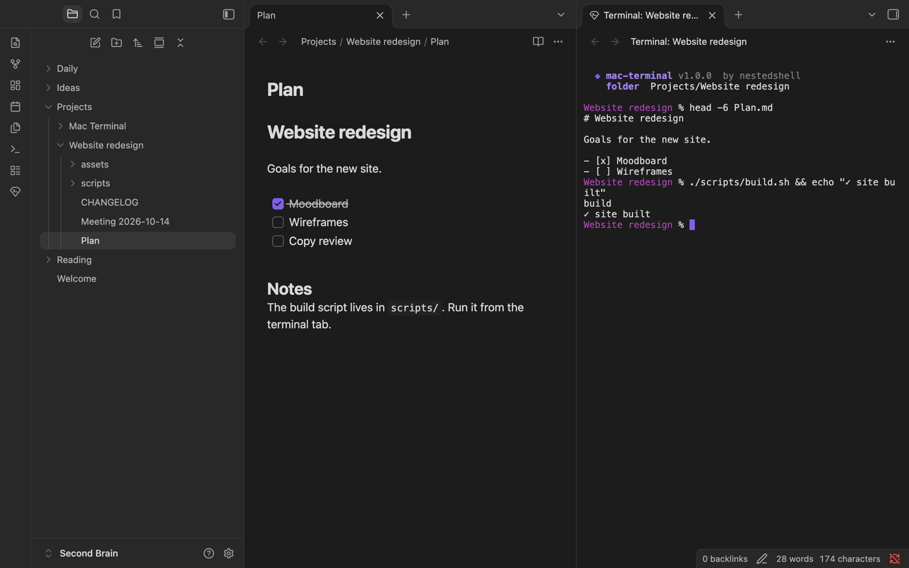

# Mac Terminal for Obsidian

Open a real terminal inside Obsidian, already in the folder you are working in.
One thing, done properly: your own login shell (zsh, bash, fish…) in an Obsidian tab, with full colors, mouse support, and TUI apps like `vim`, `htop` or `claude`.

**macOS only.**


## Opening a terminal

| How | Where it opens |
| --- | --- |
| Ribbon icon (the gem with a prompt) | Folder of the active note |
| Command palette → **Open terminal in current folder** | Folder of the active note (or of the active terminal) |
| Command palette → **Open terminal in vault root** | Vault root |
| Right-click a folder or a note → **Open in terminal** | That folder, or the note's folder |

Other commands: **Set name and color of this terminal** and **Toggle black background**.


Terminals open in a new tab by default. You can also open them in a split, or in a new window, and drag them around like any other tab: moving a tab to another window keeps the shell running and the screen intact, even with `vim` or `htop` open.

Terminal tabs are saved with your workspace, together with their name and color. After a restart they come back with the startup art, and the shell starts when you press Enter.



## Name and color

Give each terminal the name of its project and a colored dot, to find it at a glance among your tabs. Right-click inside the terminal (or on its tab) and choose **Name and color…**. The name replaces the folder name in the tab, and the dot shows up in the tab, in the header and in the startup art.


A new terminal opened from a named one (with **Open terminal in current folder**) keeps its name and color. The colors come from your Obsidian theme, so they match the rest of the app.


## Settings


- **Font size**: 8 to 32 px.
- **Black background**: pure black, like a classic terminal. Turn it off and the color below comes back. Also in the terminal's right-click menu and in the command palette.
- **Background color**: follows the Obsidian theme by default, or pick any color. The text color adapts to stay readable.
- **Startup art**: the nestedshell ninja octopus and the folder info shown when a terminal opens (a compact one-liner in narrow panes).
- **Open terminals in**: new tab, split right, split below, or new window.

Changes apply to open terminals immediately. Light themes get a light ANSI palette:


## Keyboard and mouse

While the terminal has focus, keys go to the shell, including Esc, Ctrl+C, Ctrl+R and the others. Option types characters as usual, so `@ # [ ] { }` work on an Italian keyboard. ⌘ shortcuts stay with Obsidian (⌘P, ⌘O, ⌘W, ⌘, …), except these, which the terminal handles like Terminal.app or iTerm2:

| Keys | Action |
| --- | --- |
| ⌘C / ⌘V | Copy the selection / paste |
| ⌘K | Clear the screen and scrollback |
| ⌘A | Select all |
| ⌘← / ⌘→ | Start / end of line |
| ⌘⌫ | Delete to the start of the line |
| ⌥← / ⌥→ | Previous / next word |
| ⇧↩ | New line without running the command (zsh, Claude Code…) |
| Ctrl+Tab | Next Obsidian tab |
| ⌘-click a link | Open it in the browser (http and https only) |
| ⌥-drag | Select text even when an app captures the mouse |

Right-click opens a menu with Copy, Paste, Select all, Clear, Name and color, and Black background. Dropping files from Finder, or notes from the Obsidian file explorer, types their quoted paths.

Typing `exit` (or Ctrl+D) closes the tab. If the shell is killed or ends on its own, the tab stays open with the reason; press Enter to start a new shell in the same folder.

## Install

Requirements: macOS 11 or later, Obsidian 1.7.2 or later, Node.js 20+, and the Xcode Command Line Tools (`xcode-select --install`), which compile the small terminal helper.

```sh
git clone https://github.com/nestedshell/mac-terminal.git
cd mac-terminal
npm install
npm run build
npm run install-plugin -- "/path/to/your/vault" --enable
```

Then, in Obsidian: **Settings → Community plugins**, turn community plugins on if needed, and enable **Mac Terminal**. If Obsidian was already open on that vault, reload it first (⌘P → *Reload app without saving*).

`install-plugin` keeps your settings when you update. Without `--enable` it only copies the files, and you enable the plugin yourself.

The plugin can't come from the Obsidian community directory, because that directory only distributes JavaScript and the terminal needs its native helper.

## How it works

```
Obsidian tab ── xterm.js (renders the terminal)
      │  keystrokes / output / resize (pipes)
      ▼
   mt-pty ── pseudo-terminal ── your login shell (in the vault folder)
```

- **xterm.js** draws the terminal inside the Obsidian view, themed from Obsidian's CSS variables. The cursor doesn't blink, as in Terminal.app: a blinking cursor keeps the CPU busy and costs battery.
- **mt-pty** (`native/mt-pty.c`, about 400 lines of C) owns the pseudo-terminal. The plugin starts it as a plain child process, so no native code runs inside Obsidian. Native terminal modules such as node-pty crash the whole app on *Reload app*; a separate helper can't.
- The shell is your account's login shell (the same one Terminal.app opens), started with `-l` so your `PATH` and profile are loaded even when Obsidian was launched from the Dock.

## Security

- **No shell in between.** The plugin runs your shell directly with an argument list; folder names are never put into a command line.
- **Stays in the vault.** The folder stored in the workspace is resolved inside the vault; anything that points outside falls back to the vault root. A folder that is a symbolic link to somewhere else still opens (linking a project into the vault is common), but the terminal shows where it really is before the shell starts.
- **No shell starts by itself.** Only a terminal you open starts its shell right away. A tab restored from the saved workspace, a file a synced or shared vault could alter, waits for Enter.
- **Verified helper.** The SHA-256 of `mt-pty` is built into `main.js` and checked before every use. The checked bytes are copied to a private folder in the macOS temporary directory and run from there, so nothing can swap the file between the check and the start. A modified, swapped or linked helper is refused.
- **Nothing leaks into the shell.** The helper closes every inherited file descriptor, so the shell can't reach Obsidian's sockets or files. Variables left by other terminals (iTerm, VS Code, tmux) and by Obsidian's own process (Electron, bundle id, allocator settings) are removed.
- **Safe paste.** Pasted and dropped text is stripped of escape and control characters before it reaches the shell, so clipboard content can't break out of bracketed paste and run commands.
- **Exact paths.** Dropped files are quoted for your shell (zsh and bash, fish, tcsh, elvish, nushell). Names with control or invisible bidi characters are refused, never silently altered.
- **Safe display.** Vault, folder and terminal names are cleaned before they are printed in the startup art or shown in a tab, so a crafted name can't inject escape sequences or hide text with bidi controls. Dot colors are limited to the theme's own colors.
- **Output can't freeze Obsidian.** Escape sequences that ask the terminal to repeat an action billions of times are dropped, and huge runs of combining marks are shortened, so `cat` on a hostile file can't hang the app.
- **Safe links.** Only ⌘-click opens links, only `http:` and `https:`, and never a link with a user name in it (`https://bank.com@evil.example`). Hovering a link shows its real host first, in plain ASCII, so look-alike letters and hyperlinks whose text differs from their target stand out.
- **Clean shutdown.** Closing a tab hangs up the shell and its jobs (SIGHUP, then SIGKILL after a grace period). So do disabling the plugin, reloading and quitting Obsidian.
- **Bounded resources.** The helper uses fixed-size buffers; when Obsidian falls behind on a flood of output, the shell is paused instead of filling memory. Input for a program that stopped reading is capped too.
- **Strict settings.** Settings and saved state are validated on load; unknown or malformed values fall back to defaults.
- **Safe installer.** `install-plugin` replaces only the plugin's own files and refuses a symlinked plugin folder, so it can never delete anything else. With `--enable` it adds the plugin to your list of enabled plugins and keeps the others; if that list can't be read, it changes nothing.

## Obsidian stays untouched

The plugin doesn't modify Obsidian or its libraries and patches no global object. Its styles only apply inside the terminal, and its keyboard handling only applies while the terminal has focus. It never writes to your notes: it only stores its settings (`data.json`) through Obsidian's API, and keeps the verified copy of its helper in the macOS temporary folder. Everything it registers is removed when you disable it. To uninstall, delete `.obsidian/plugins/mac-terminal`.

## Development

```sh
npm run dev        # rebuild on change
npm run check      # typecheck, tests, build
npm test           # unit and integration tests (they compile mt-pty and drive real shells)
```

| Path | What it is |
| --- | --- |
| `src/main.ts` | Plugin entry: commands, ribbon, file menu, settings |
| `src/terminal-view.ts` | The terminal tab: xterm.js, keyboard, clipboard, lifecycle |
| `src/pty.ts` | Starts and talks to the helper |
| `native/mt-pty.c` | The pseudo-terminal helper |
| `src/shell.ts`, `src/paths.ts`, `src/text.ts` | Shell and environment, vault paths, sanitizing and quoting |
| `src/banner.ts`, `src/theme.ts`, `src/icon.ts` | Startup art, colors, icon |
| `src/tag.ts`, `src/tag-modal.ts` | Name and color of a terminal |
| `src/guards.ts` | Limits on escape sequences that would freeze the terminal |
| `scripts/build.mjs`, `scripts/install.mjs` | Build into `dist/mac-terminal`, install into a vault |

The build also patches one line of xterm.js: it detects Node.js-like environments and then ignores the Mac, which would turn Option into Meta. The build stops if a future xterm version changes that line.

## Known limitations

- After *Reload app*, the helper processes of terminals that were open remain as inactive "zombie" entries (no CPU, no memory) until Obsidian quits. Their shells have already been closed.
- Obsidian uses native macOS menus by default; the right-click menu of the terminal follows that setting.

## License

MIT © nestedshell. Bundles [xterm.js](https://github.com/xtermjs/xterm.js) (MIT).
