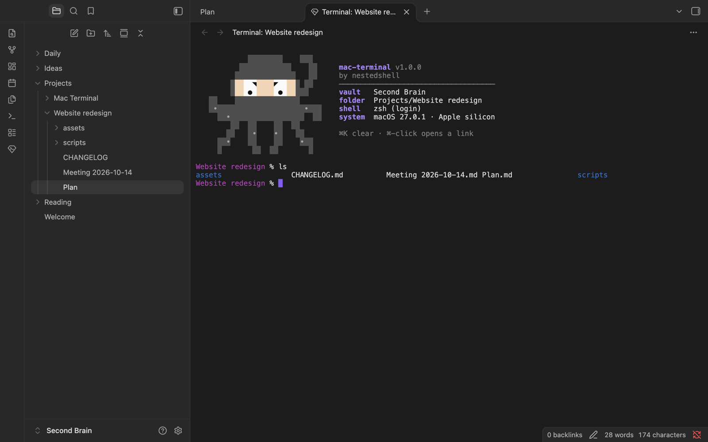
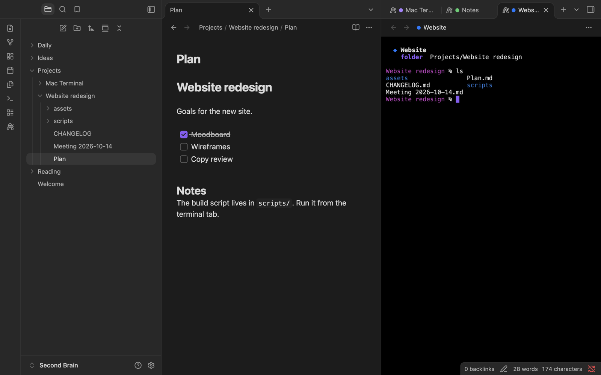

# Embedded Mac Terminal

A real terminal inside Obsidian, next to your note and already in its folder.



## What it's for

Notes often live next to code, scripts and project files. When you need to run a build, use git, or start `claude` or `vim` there, Embedded Mac Terminal opens your own shell in a split beside the note, already in the note's folder. You don't switch apps and you don't `cd`.

- **Opens where you work:** the folder of the active note, the vault root, or any folder you right-click.
- **Your real shell:** zsh, bash or fish with your `PATH` and profile, full colors, mouse support and full-screen apps such as `vim`, `htop` or `claude`.
- **Feels like a Mac terminal:** ⌘C, ⌘V, ⌘K and the usual shortcuts work, Option types `@ # [ ]` as in any Mac app, and ⌘-click opens links.
- **Names and colors:** give each terminal its project name and a colored dot.
- **Looks like Obsidian:** it follows your theme, or you pick black, white or a few calm backgrounds.

It needs macOS 11 or later (Apple silicon or Intel) and Obsidian 1.7.2 or later. It doesn't run on Windows, Linux or mobile.

## How to use it

Open a terminal in one of three ways:

- click the ninja octopus in the left ribbon;
- run **Open terminal in current folder** from the command palette (⌘P);
- right-click a folder or a note and choose **Open in terminal**.


The terminal opens in a split next to the note, side by side or stacked. To tell your projects apart, right-click a terminal and choose **Name and color…**:



In **Settings → Embedded Mac Terminal** you choose the font size, the background, the startup art and where terminals open:


Type `exit` or press Ctrl+D to close a terminal. Terminals are saved with your workspace: after a restart they come back, and the shell starts when you press Enter.

The [guide](docs/guide.md) lists every command, setting and shortcut.

## How it works

```
Obsidian tab ── xterm.js (draws the terminal)
      │  keystrokes, output, resize
      ▼
   mt-pty ── pseudo-terminal ── your login shell, in the note's folder
```

- **xterm.js** draws the terminal in an Obsidian tab, with the colors and font of your theme.
- **mt-pty** is a small C program ([`native/mt-pty.c`](native/mt-pty.c)) that runs the pseudo-terminal in its own process. No native code runs inside Obsidian, so *Reload app* can't crash it.
- **Three files, nothing else.** `mt-pty` travels inside `main.js` with its SHA-256. Before starting it, the plugin checks it, copies it to a private temporary folder and runs it from there. There is nothing to download and no macOS security setting to change.
- **A login shell**, as in Terminal.app, so your `PATH` and profile are loaded even when Obsidian was opened from the Dock.

## Install

1. Download `mac-terminal-<version>.zip` from the [latest release](https://github.com/nestedshell/obsidian-mac-terminal/releases/latest) and unzip it.
2. In Obsidian, open **Settings → Community plugins**, turn community plugins on, and click the folder icon next to **Installed plugins**.
3. Drag the `mac-terminal` folder into the folder that opens. Click the refresh icon and enable **Embedded Mac Terminal**.

To update, copy the three new files into the `mac-terminal` folder and reload Obsidian. To build it yourself, see [Development](docs/development.md).

## What the plugin accesses

- **Runs programs.** It starts your login shell, and the commands you type run with your user's permissions, as in Terminal.app.
- **Files outside the vault.** A terminal can reach any folder your account can. The plugin itself writes only its settings (`data.json`, in its plugin folder) and a copy of its helper in `$TMPDIR/mac-terminal-<user id>/`. It also reads which shell your account uses and which locales are installed.
- **Clipboard, only when you ask.** It writes the selection when you copy (⌘C or the menu) and reads the clipboard only when you paste (⌘V or the menu).
- **No network, no accounts, no telemetry.**
- **Open source, helper included.** The long base64 string in `main.js` is `native/mt-pty`, compiled from `native/mt-pty.c`. The build is reproducible, and each release is built by GitHub Actions with a provenance attestation.

It also protects you from hostile pastes, file names, links and terminal output: [Security](docs/security.md) explains how.

## License

MIT © nestedshell. Bundles [xterm.js](https://github.com/xtermjs/xterm.js) (MIT).
