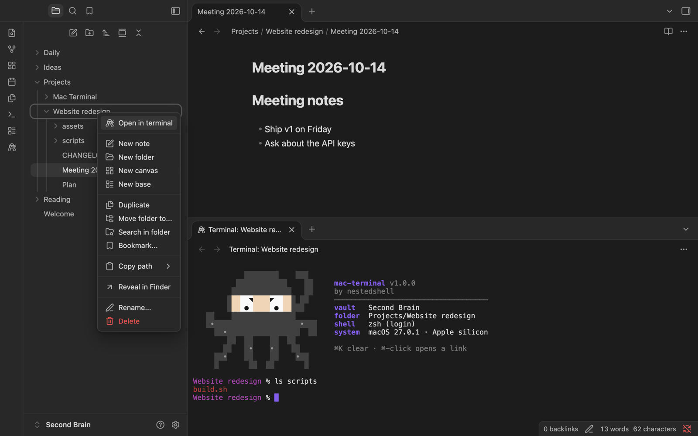
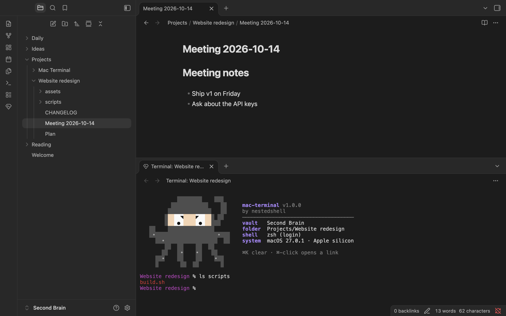
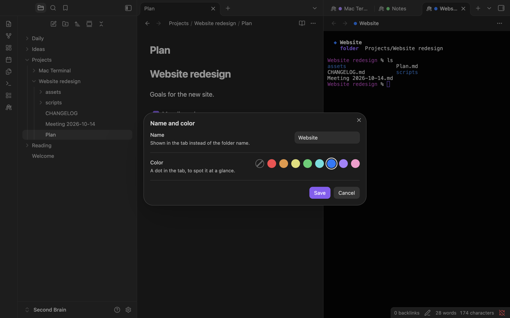
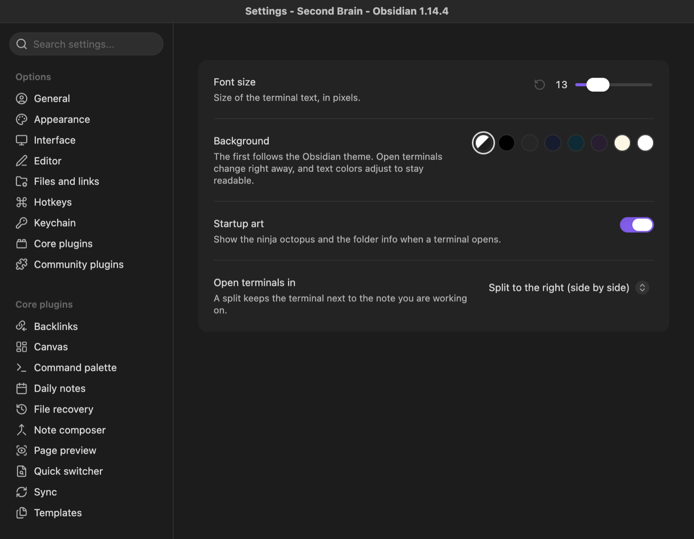
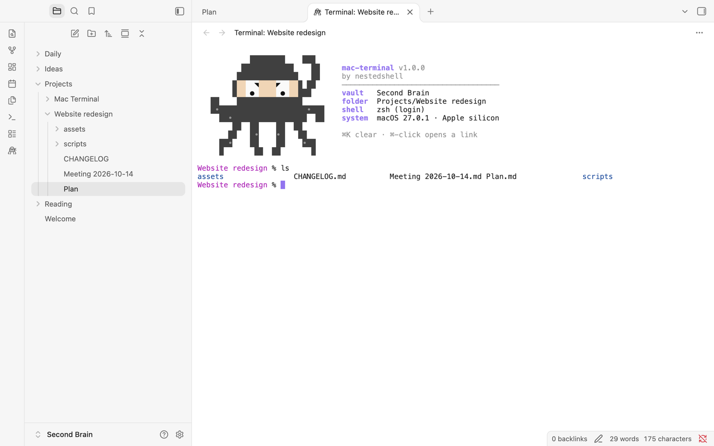

# Guide

Everything Embedded Mac Terminal can do. For a short overview, see the [README](../README.md).

## Install by hand

1. Get the `mac-terminal` folder: download `mac-terminal-<version>.zip` from the [latest release](https://github.com/nestedshell/obsidian-mac-terminal/releases/latest) and double-click it to unzip. (Or build it yourself, see [Development](development.md).)
2. In Obsidian, open **Settings → Community plugins** and turn community plugins on if they are off.
3. Next to **Installed plugins**, click the folder icon: Finder opens your vault's plugins folder.
4. Drag the `mac-terminal` folder into it. You should end up with:

   ```
   Your Vault/
   └── .obsidian/
       └── plugins/
           └── mac-terminal/
               ├── main.js
               ├── manifest.json
               └── styles.css
   ```

5. Back in Obsidian, click the refresh icon next to **Installed plugins** and enable **Embedded Mac Terminal**.
6. Click the octopus icon in the left ribbon, or run **Open terminal in current folder** from the command palette (⌘P).

You can also do it all in Finder: the plugins folder is `.obsidian/plugins` inside your vault (press **⌘⇧.** to show hidden folders).

**Updating:** copy the three new files into the existing `mac-terminal` folder, replacing the old ones, then reload Obsidian (⌘P → *Reload app without saving*). Don't replace the whole folder: it also holds your settings (`data.json`).

**Uninstalling:** disable the plugin, then delete the `mac-terminal` folder.

**Several Macs:** the whole plugin is these three files, so Obsidian Sync (with community plugins turned on in its settings) brings it to your other Macs by itself.

**macOS security:** the small helper program that runs the terminal, `mt-pty`, travels inside `main.js`. When you open a terminal, the plugin checks it against its fingerprint (SHA-256), writes it to a private folder in the macOS temporary directory and runs it from there. You don't need to change any security setting.

## Opening a terminal

| How | Where it opens |
| --- | --- |
| Ribbon icon (the ninja octopus) | Folder of the active note |
| Command palette → **Open terminal in current folder** | Folder of the active note (or of the active terminal) |
| Command palette → **Open terminal in vault root** | Vault root |
| Right-click a folder or a note → **Open in terminal** | That folder, or the note's folder |

Other commands: **Set name and color of this terminal**, **Toggle black background** and **Toggle white background**.



Terminals open in a split next to the note you are working on: side by side by default, or stacked below it (**Settings → Open terminals in**). A terminal opened while another terminal is active joins it as a tab, so the screen isn't split again and again, and an empty pane is simply reused. You can also choose a new tab or a new window, and drag terminals around like any other tab: moving one to another window keeps the shell running and the screen intact, even with `vim` or `htop` open.

Terminal tabs are saved with your workspace, together with their name and color. After a restart they come back with the startup art, and the shell starts when you press Enter.



## Name and color

Give each terminal the name of its project and a colored dot, to find it at a glance among your tabs. Right-click inside the terminal (or on its tab) and choose **Name and color…**. The name replaces the folder name in the tab, and the dot shows up in the tab, in the header and in the startup art.

A new terminal opened from a named one (with **Open terminal in current folder**) keeps its name and color. The colors come from your Obsidian theme, so they match the rest of the app.



## Settings



- **Font size**: 8 to 32 px.
- **Background**: one dot per background: the Obsidian theme's (the default), black, graphite, midnight blue, deep teal, plum, paper and white. Open terminals change right away, startup art included, and the text color adapts to stay readable. Black and white are also in the terminal's right-click menu and in the command palette.
- **Startup art**: the nestedshell ninja octopus and the folder info shown when a terminal opens (a compact one-liner in narrow panes).
- **Open terminals in**: split to the right (side by side, the default), split below (stacked), new tab, or new window.

Changes apply to open terminals immediately. Light themes get a light ANSI palette:



## Keyboard and mouse

While the terminal has focus, keys go to the shell, including Esc, Ctrl+C, Ctrl+R and the others. Option types characters as usual, so `@ # [ ] { }` work on an Italian keyboard. ⌘ shortcuts stay with Obsidian (⌘P, ⌘O, ⌘W, ⌘, …), except these, which the terminal handles like Terminal.app or iTerm2:

| Keys | Action |
| --- | --- |
| ⌘C / ⌘V | Copy the selection / paste |
| ⌘K | Clear the screen and scrollback |
| ⌘A | Select all |
| ⌘← / ⌘→ | Start / end of line |
| ⌘⌫ | Delete to the start of the line |
| ⌥← / ⌥→ | Previous / next word |
| ⇧↩ | New line without running the command (zsh, Claude Code…) |
| Ctrl+Tab | Next Obsidian tab |
| ⌘-click a link | Open it in the browser (http and https only) |
| ⌥-drag | Select text even when an app captures the mouse |

Right-click opens a menu with Copy, Paste, Select all, Clear, Name and color, Black background and White background. Dropping files from Finder, or notes from the Obsidian file explorer, types their quoted paths.

Typing `exit` (or Ctrl+D) closes the tab. If the shell is killed or ends on its own, the tab stays open with the reason; press Enter to start a new shell in the same folder.

## Known limitations

- After *Reload app*, the helper processes of terminals that were open remain as inactive "zombie" entries (no CPU, no memory) until Obsidian quits. Their shells have already been closed.
- Obsidian uses native macOS menus by default; the right-click menu of the terminal follows that setting.
